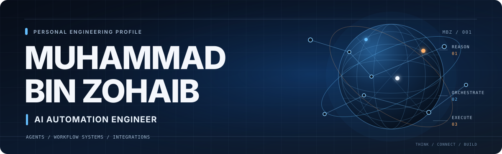
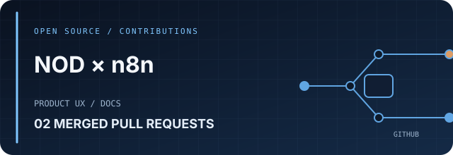
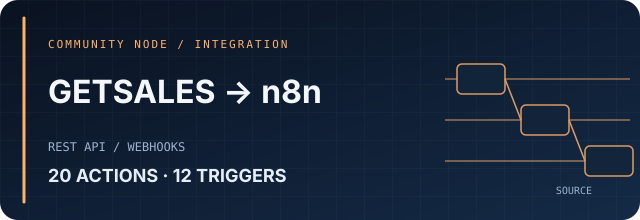
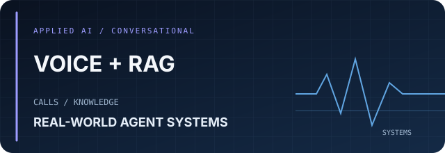
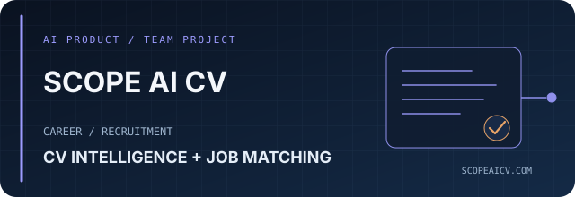

<!-- Profile README for Muhammad Bin Zohaib -->

  

  

  
  

  <strong>n8n Certified Expert</strong> &nbsp;·&nbsp; <strong>Verified Creator</strong> &nbsp;·&nbsp; <strong>Community Node Builder</strong>

---

## 01 / About

I'm **Muhammad Bin Zohaib**, an AI Automation Engineer focused on turning LLM capabilities into useful, dependable systems.

I build across the layer where AI meets real operations: tool-using agents, workflow orchestration, Voice AI, and API-level integrations. My work combines platforms like n8n and Make with JavaScript, Python, webhooks, and custom integrations when a system needs more control than a connector can offer.

I care about what makes an AI solution work beyond a demo: reliable execution, clean data, thoughtful human review, and systems that remain understandable after they ship.

## 02 / What I engineer

<table width="100%">
  <tr>
    <td width="33%" valign="top">
      
<strong>01 &nbsp; AGENT SYSTEMS</strong>

      
LLM agents, tool calling, structured outputs, RAG, multi-step orchestration, and human-in-the-loop decisions.

    </td>
    <td width="33%" valign="top">
      
<strong>02 &nbsp; WORKFLOW ENGINEERING</strong>

      
n8n and Make systems, event-driven automation, CRM operations, data synchronization, routing, and monitoring.

    </td>
    <td width="33%" valign="top">
      
<strong>03 &nbsp; INTEGRATION ENGINEERING</strong>

      
REST APIs, webhooks, authentication, custom nodes, SaaS integrations, and code-led automation.

    </td>
  </tr>
</table>

## 03 / Selected engineering

<table width="100%">
  <tr>
    <td width="50%" valign="top">
      
      <h3>Open-source · Nod / n8n</h3>
      
Two merged contributions to n8n's Nod project: improved model-management UX and a clearer docs-only contributor workflow.

      
<a href="https://github.com/n8n-io/nod/pull/1117">PR #1117</a> &nbsp;·&nbsp; <a href="https://github.com/n8n-io/nod/pull/1101">PR #1101</a>

    </td>
    <td width="50%" valign="top">
      
      <h3>GetSales · n8n community node</h3>
      
Built a custom integration with 20 actions and 12 webhook triggers, connecting GetSales resources and events to n8n workflows.

      
<a href="https://github.com/ProMBZ/n8n-nodes-getsales">Explore the source</a>

    </td>
  </tr>
  <tr>
    <td width="50%" valign="top">
      
      <h3>Voice AI + knowledge systems</h3>
      
Built conversational systems for restaurant ordering and live kitchen handoff, dental appointment scheduling, and a production RAG knowledge assistant.

    </td>
    <td width="50%" valign="top">
      
      <h3>Scope AI CV · team project</h3>
      
AI-powered career and recruitment platform covering CV parsing, skills extraction, job matching, skill-gap analysis, and recruiter workflows.

      
<a href="https://scopeaicv.com/">Visit Scope AI CV</a>

    </td>
  </tr>
</table>

Also part of my work: <a href="https://github.com/ProMBZ/Lunex">Lunex</a> — a family-built lunar exploration project for NASA Space Apps Challenge 2026.

## 04 / Professional experience

| Role | Organization | Period |
|---|---|---|
| Automation & Knowledge Engineer | Sending.ac | Mar – Sep 2026 |
| Lead AI Developer | AI Resolute Group | Oct – Nov 2025 |
| AI Automation Engineer | Fluence | Jun 2025 |
| AI Developer | NextAxion | Apr – Jun 2025 |

## 05 / Technical toolkit

- **AI & agent development:** OpenAI, Anthropic Claude, Mistral, LangChain, LangGraph, RAG, tool calling
- **Automation:** n8n, Make, event-driven workflows, custom community nodes
- **Voice AI:** Vapi, Retell AI, conversational systems
- **Engineering:** JavaScript, TypeScript, Python, Node.js, Next.js, REST APIs, webhooks
- **Platforms & data:** Airtable, Supabase, CRM systems, SaaS integrations

---

  <strong>Open to remote opportunities in AI Automation Engineering, AI Agent Engineering, and integration-focused roles.</strong>
   
  <a href="https://www.linkedin.com/in/mbz1415/">The best way to reach me is on LinkedIn.</a>

