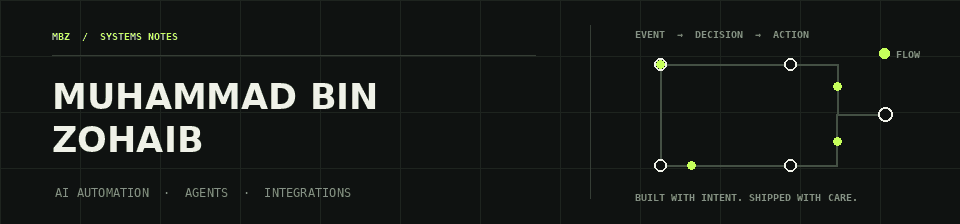

  

  <a href="https://aicoders.dev/">AI Coders</a> ·
  <a href="https://www.linkedin.com/in/mbz1415/">LinkedIn</a> ·
  <a href="mailto:muhammad.specials@gmail.com">Email</a> ·
  Karachi, Pakistan

I build **AI agents and automation systems** that connect business tools, data, and people.

Most of my work sits around **n8n, Make, APIs, webhooks, and Voice AI**, with JavaScript and Python when a workflow needs more than a connector. I care about the unglamorous engineering too: clean data, reliable handoffs, and systems people can trust.

n8n Certified Expert · Verified Creator · Community Node Builder

## Selected work

- **[GetSales → n8n](https://github.com/ProMBZ/n8n-nodes-getsales)** — Built a community node with 20 actions and 12 webhook triggers.
- **[Scope AI CV](https://scopeaicv.com/)** — Team-built career and recruitment platform for CV parsing, job matching, and recruiter workflows.
- **[Lunex](https://github.com/ProMBZ/Lunex)** — A family-built lunar exploration project for the 2026 NASA Space Apps Challenge.

## Tools I reach for

`n8n` · `Make` · `OpenAI` · `Claude` · `Vapi` · `Retell` · `Airtable` · `REST APIs` · `JavaScript` · `Python`

## Now

Founder at [AI Coders](https://aicoders.dev/), building AI systems, integrations, and automations for real business operations.

I enjoy turning messy, manual processes into dependable systems.