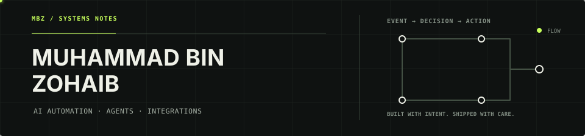

<!-- Muhammad Bin Zohaib | GitHub Profile README -->

  

  

  <a href="https://www.linkedin.com/in/mbz1415/"><strong>LinkedIn ↗</strong></a>
  &nbsp; · &nbsp;
  <a href="mailto:muhammad.specials@gmail.com">Email</a>

---

## About

I'm **Muhammad Bin Zohaib**, an AI Automation Engineer. I enjoy taking a process that's slow, repetitive, or spread across too many tools and figuring out how to make it work better with AI and automation.

Most of my work sits around **AI agents and workflow automation**. I build n8n and Make systems, connect language models to APIs and business tools, and develop Voice AI experiences that can do more than hold a conversation. When a workflow needs custom behaviour, I use JavaScript, Python, webhooks, and REST APIs to build the missing pieces rather than forcing a solution through tools that don't quite fit.

What I enjoy most is making all the parts work together: shaping the logic, handling edge cases, keeping data consistent, and knowing where a human should stay in the loop. I care about what happens after the demo, when a system has to be dependable, understandable, and useful in someone's day-to-day work.

### Areas I work in

- **AI agents:** Tool calling, structured outputs, RAG, multi-step reasoning, and human-in-the-loop workflows.
- **Automation & integrations:** n8n, Make, custom nodes, APIs, webhooks, CRM systems, and operational workflows.
- **Voice AI:** Conversational agents, call automation, appointment flows, and integrations using Vapi and Retell.

  <strong>n8n Certified Expert</strong> &nbsp;·&nbsp; <strong>Verified Creator</strong> &nbsp;·&nbsp; <strong>Community Node Builder</strong>

